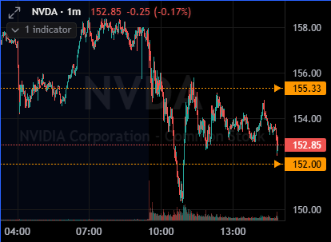
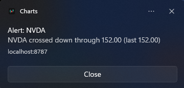
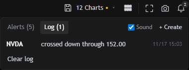
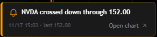

# Features

## Charts and timeframes

Candles on a dark, TradingView-style chart with 1m, 2m, 5m, 15m, 30m, 1h, daily
and weekly timeframes. The legend shows open, high, low, close and change for
the bar under the crosshair.

Each chart remembers its zoom and scroll for every timeframe, so it reopens
showing the same span you left it on. **Alt+R** (or the corners icon) puts it
back to the default view.

Intraday charts load about ten days of 1-minute history (more for the longer
timeframes), so a 1m chart still has several sessions on a Monday morning.

## Multi-chart layouts

The layout button (grid icon, top right) splits the screen into 1, 2, 3, 4, 6,
8, 12 (6 × 2) or 24 (12 × 2) charts. Each chart keeps its own symbol, timeframe,
chart type and indicators.

- Click a chart to make it active (blue outline). The top bar, drawing tools and
  watchlist act on the active chart.
- Click a chart's title to change its symbol.
- ++tab++ / ++shift+tab++ cycles through charts, and ++alt+enter++ (or the arrows
  icon in a chart's legend) maximizes one chart and restores the layout.
- **Sync** options in the layout menu: symbol, interval, crosshair (on by
  default) and date range. Date-range sync lines charts up by their left edge,
  and when the active chart is at the latest bar, every chart ends at its latest
  bar.

## Extra windows

Open the layout menu, then **Windows → + New window** for another app window,
for example on a second monitor. Each window has its own charts, layout and
choice of watchlist (pick it from the watchlist's name). Watchlists, drawings,
alerts, saved layouts and settings are shared and stay in sync between open
windows, and only one window fires each alert.

Extra windows reopen with the main window at their last size and position, and
closing the main window closes the others. Rename or delete them from the same
menu. The first time, allow pop-ups for `localhost` when your browser asks.

{ .screenshot loading=lazy }

## Volume profile and TPO

| Tool | What it shows |
|---|---|
| **Volume Profile, Visible Range** | Volume at each price for the bars on screen (on by default) |
| **Session Volume Profile** | One profile per trading session |
| **Fixed Range** | A profile for a range you pick with the range tool in the left toolbar |
| **TPO (Market Profile)** | Letters per 30-minute period (blocks when zoomed out), with initial balance |

Each profile marks the point of control (POC) and the value area high and low
(VAH, VAL), with labels on the price axis.

!!! note "Buy/sell split is an estimate"
    The buy and sell colors in a profile are estimated from where each bar closed
    within its range. They are not true bid/ask order flow, which candle data
    doesn't include. The chart labels this "≈ buy/sell from bars".

## Indicators

Open **Indicators** (or press ++slash++) and star the ones you use to keep them in
Favorites. Hover a legend row to hide, edit or remove an indicator.

- Moving averages (simple and exponential)
- Bollinger Bands
- VWAP (session) and Anchored VWAP
- Key levels: previous session high, low and close, and today's open
- RSI, MACD and Average True Range in their own panes
- Volume

**Anchored VWAP:** pick the anchor tool in the left toolbar, then click a bar.
Bands and the anchor time are in its settings.

## Drawing tools

The toolbar on the left scrolls without a scrollbar: when the window is too
short to show every tool, small up and down arrows appear at its ends.

Trend line, ray, horizontal line and ray, vertical line, rectangle, circle, fib
retracement, text and a measure tool. Click a drawing to select it, drag to move
it, and press ++delete++ to remove it. The magnet snaps to open, high, low and
close. ++ctrl+z++ and ++ctrl+y++ undo and redo.

Drawings are saved per symbol. Horizontal lines and rays show on every chart of
that symbol; select a drawing and use **This chart / All charts** to change that.

## Price alerts

Set an alert in whichever way is handiest:

- Right-click a chart and choose **Add alert**.
- Press ++alt+a++ to set one at the price under the cursor.
- Click **Add alert** on a horizontal line's toolbar.
- Click the bell button, then **+ Create**.

Each alert is **crossing**, **crossing up** or **crossing down** a price, and
fires **only once** or **every time** (at most once a minute), with an optional
message. Alerts show as orange lines with a small arrow on the chart, and you
can drag a line to move its alert.

When an alert fires you get a chime, a pop-up in the app, a Windows or Mac
notification and an entry in the bell menu's **Log**. The bell menu lists every
alert, where you can edit, stop, restart or delete them, and turn the sound off.

!!! note "Alerts need the app open"
    Alerts are checked while the app is running (it can be in the background).
    For stocks outside regular hours they use the pre-market or after-hours price.

<figure markdown="span">

{ .screenshot loading=lazy }

<figcaption>Alert lines on the chart</figcaption>
</figure>

<figure markdown="span">

{ .screenshot loading=lazy }

<figcaption>Windows or Mac notification</figcaption>
</figure>

<figure markdown="span">

{ .screenshot loading=lazy }

<figcaption>The bell menu's Log</figcaption>
</figure>

<figure markdown="span">

{ .screenshot loading=lazy }

<figcaption>Pop-up in the app</figcaption>
</figure>

## Watchlist

Click **+** to add symbols, and the ⋮ menu to choose columns: Last, Change,
Change %, Volume and **Ext**, the pre-market or after-hours change for stocks
(hover it for the price). Click a symbol to load it in the active chart.

**Several watchlists:** click the watchlist's name to create a new list, make a
copy, rename it, switch between lists, or delete one (× on hover). For example,
keep a "Futures" list next to an "Earnings week" list.

**Hide it for more room:** click **»** in the watchlist header, or the list
button at the top right. The list button or the tab at the right edge of the
charts brings it back. Each window remembers whether its watchlist is shown.

## Extended hours

The **RTH / ETH** button in the status bar switches stock charts between regular
hours only and extended hours. Pre-market and after-hours bars are shaded on
intraday stock charts (you can turn the shading off in Settings).

## Saved layouts

The layout name button at the top right saves the whole screen: every chart's
symbol, timeframe and indicators. **Save layout** (++ctrl+s++), **Save as new
layout**, **Rename**, and a list of saved layouts to switch between. A dot after
the name means unsaved changes.

## Display settings

**Settings → Display** has the chart **background colour** and the **chart
padding**: space above and below the candles (in %) and to the right of the
last bar (in bars). Each has a **Default** button to put it back. The right
padding is kept when you switch timeframes.

## Other touches

- **Save image:** the camera icon saves the active chart as a PNG.
- **Watermark:** a large, faint ticker with the company name below it, behind
  each chart (Settings → Display).
- **Time zone:** status bar button or Settings.
- Everything (layout, watchlist, drawings, settings) is remembered in your
  browser for next time.
