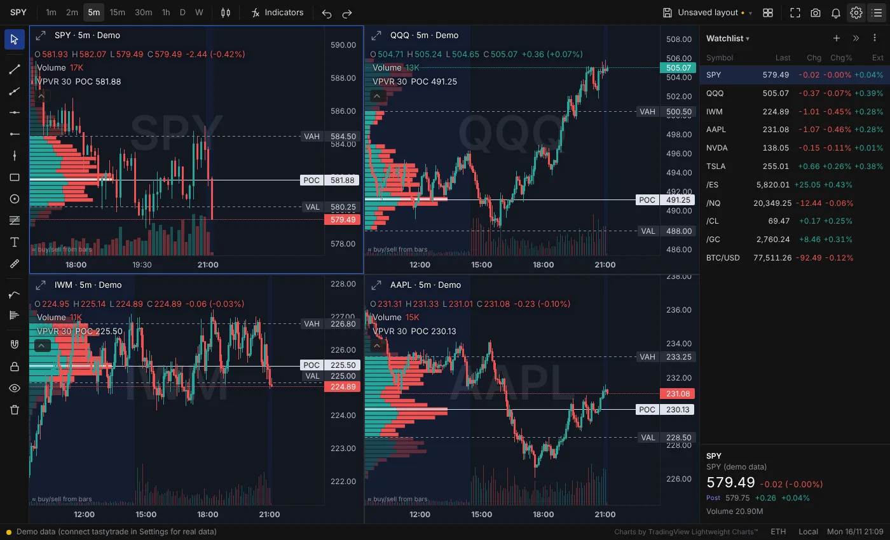

# Desktop Charts

A TradingView-style charting app that runs on your own computer and opens in
your web browser. Up to 24 charts per window, extra windows for more screens, volume profile and TPO,
anchored VWAP, drawing tools, price alerts and watchlists, with live market data from your
tastytrade account. Without an account it runs on demo data, so anyone can try it.

[:material-download: Download](https://github.com/trader-larry/desktop-charts/releases/latest){ .md-button .md-button--primary target=_blank rel=noopener }
[:fontawesome-brands-github: View on GitHub](https://github.com/trader-larry/desktop-charts){ .md-button target=_blank rel=noopener }
[:material-rocket-launch: Get started](getting-started.md){ .md-button }

{ .screenshot }

## Latest release

**[v1.0.0](https://github.com/trader-larry/desktop-charts/releases/tag/v1.0.0){ target=_blank rel=noopener }**, released November 26, 2026. This is the first
release you can download as a ready-to-run zip: get `desktop-charts-v1.0.0.zip`
(151 KB) under **Assets** on the [latest release](https://github.com/trader-larry/desktop-charts/releases/latest){ target=_blank rel=noopener } page. You
don't need git or a GitHub account. Then follow [Getting started](getting-started.md).

What's in it:

- **Extra chart windows** that reopen at their saved size and position, plus
  12- and 24-chart layouts.
- **Price alerts**, multiple watchlists sortable by any column, and zoom memory per timeframe.
- **SPX Levels** indicator for SPX and XSP.
- **4h timeframe**, and line style, thickness, coordinate editing and a price
  label toggle for drawings.
- **Update notice:** the status bar tells you when a newer version is out.

See the [full release notes](https://github.com/trader-larry/desktop-charts/releases/tag/v1.0.0){ target=_blank rel=noopener } for every change.

## Why I built it

I wanted charts that I can customize myself, create my own multi window layouts, add specific custom indicators, and display futures and/or stocks, driven by the data feed I already have through tastytrade. Web charting sites put the features I use behind a subscription, and my broker's platform doesn't lay charts out the way I like or has limitations that I can overcome by coding myself. This one runs locally, keeps my API keys on my own machine, and only ever reads market data.

## At a glance

| | |
|---|---|
| **Runs on** | Windows, macOS, Linux (Node.js 18 or newer) |
| **Latest version** | [v1.0.0](https://github.com/trader-larry/desktop-charts/releases/tag/v1.0.0){ target=_blank rel=noopener }, November 26, 2026 ([download](https://github.com/trader-larry/desktop-charts/releases/latest){ target=_blank rel=noopener }) |
| **Data** | tastytrade DXLink streaming (stocks, ETFs, futures, crypto), or built-in demo data |
| **Charts** | TradingView's open-source [Lightweight Charts™](https://www.tradingview.com/lightweight-charts/){ target=_blank rel=noopener } library |
| **Privacy** | Runs at `http://localhost:8787`; your tastytrade keys stay in a local `config.json` and never reach the browser |
| **Account access** | Read-only charting: it never touches accounts, positions or orders |
| **Dependencies** | None to install beyond Node.js |
| **License** | MIT (Lightweight Charts is Apache 2.0) |

## Highlights

- **Multi-chart layouts:** 1, 2, 3, 4, 6, 8, 12 or 24 charts, each with its own
  symbol, timeframe and indicators, with optional symbol, interval, crosshair and
  date sync.
- **Extra windows:** open more chart windows, for example one per monitor,
  sharing your watchlists, drawings and alerts.
- **Volume profile and TPO:** visible range, session and fixed range profiles
  with POC, VAH and VAL, plus a TPO (Market Profile) with initial balance.
- **Anchored VWAP:** click any bar to anchor it, with optional bands.
- **SPX Levels:** type in the day's posted SPX levels and see them on SPX or XSP
  charts (divided by 10 on XSP).
- **Drawing tools:** trend lines, rays, horizontal lines, rectangles, fib
  retracements, text and a measure tool, saved per symbol.
- **Price alerts:** right-click a chart or press Alt+A, and get a chime, a pop-up
  and a desktop notification when price crosses your level.
- **Watchlists:** as many named lists as you like, with last, change, volume and
  pre-market / after-hours change for stocks, sortable by any column.
- **Saved layouts:** keep a "Scalping" and a "Swing" setup and switch between them.

See the full [feature tour](features.md) or the [screenshots](screenshots.md).

!!! note
    This is a charting tool for information only, not investment advice. It is
    not affiliated with TradingView or tastytrade. Data can be delayed or wrong.
