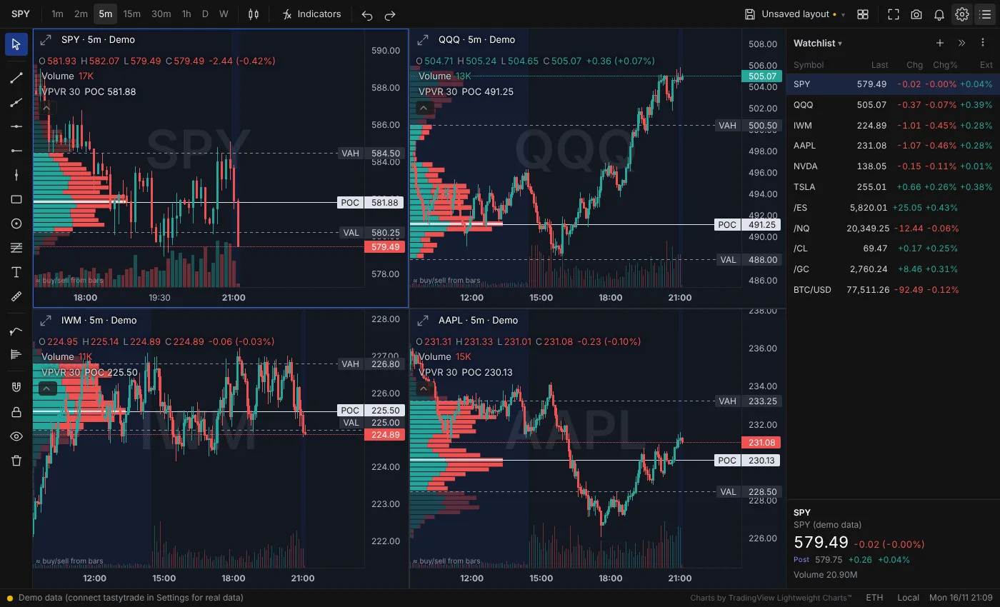
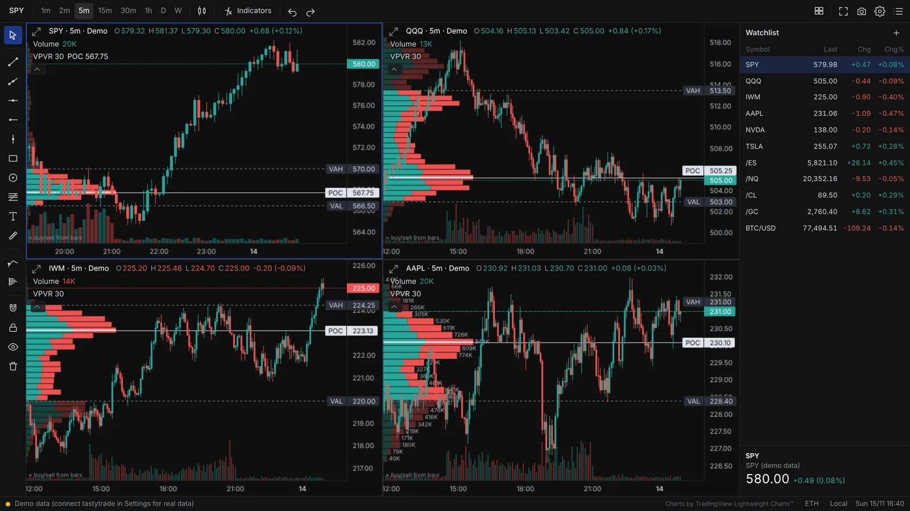
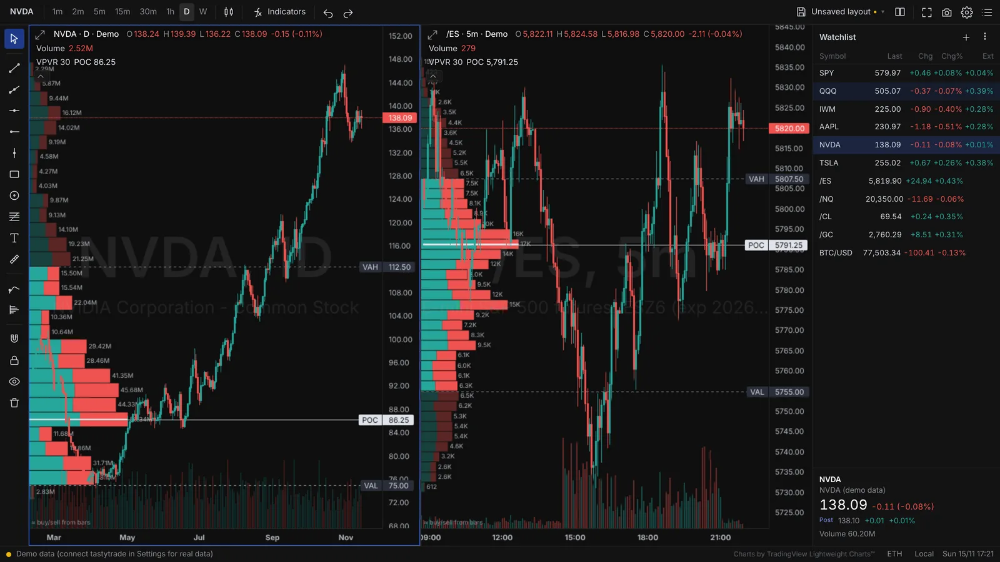
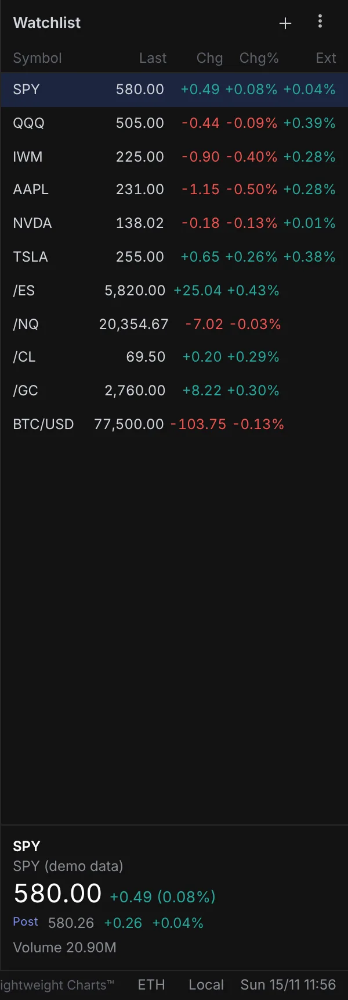

# Screenshots

All screenshots use the built-in demo data, so the prices are synthetic.

## Four-chart layout

SPY, /ES, NVDA and QQQ on different timeframes, each with a visible-range
volume profile, POC and value area.

{ .screenshot loading=lazy }

## Same timeframe across charts

Four 5-minute charts side by side with interval sync on.

{ .screenshot loading=lazy }

## Extended hours shading

Pre-market and after-hours bars are shaded on intraday stock charts. The
watchlist's Ext column shows the extended-hours change.

{ .screenshot loading=lazy }

## Watermark

A large, faint symbol, timeframe and description behind each chart.

{ .screenshot loading=lazy }

## Saved image

What the camera button saves: the chart with its legend, indicators and drawings.

{ .screenshot loading=lazy }

## Saved layouts

Switch between named layouts, such as a one-chart "Scalping" setup and a
four-chart "Swing" setup.

{ .screenshot loading=lazy }

## Watchlist

Last, change, change % and the extended-hours (Ext) column, with details for
the selected symbol at the bottom.

{ .screenshot loading=lazy width="320" }
