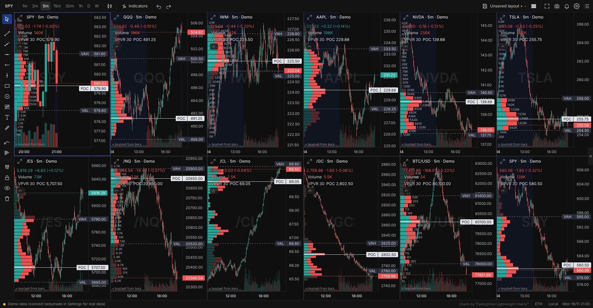
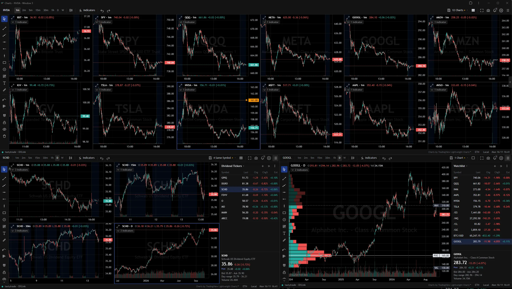
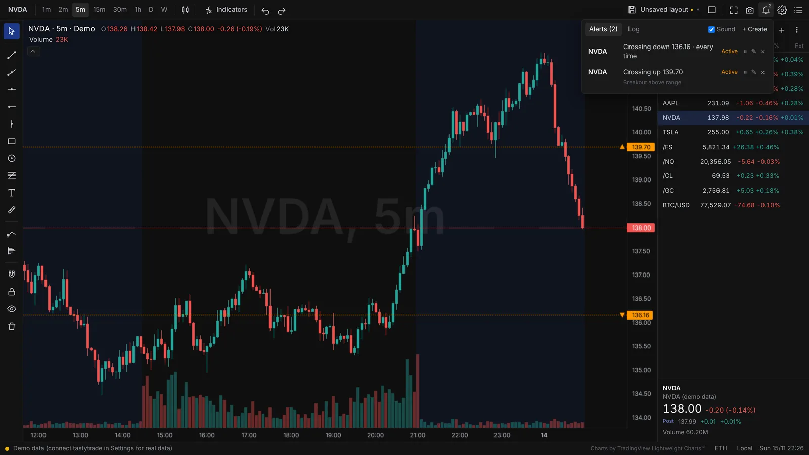
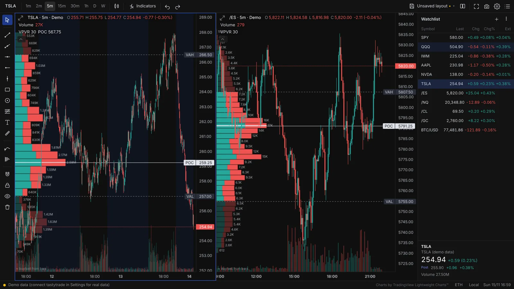
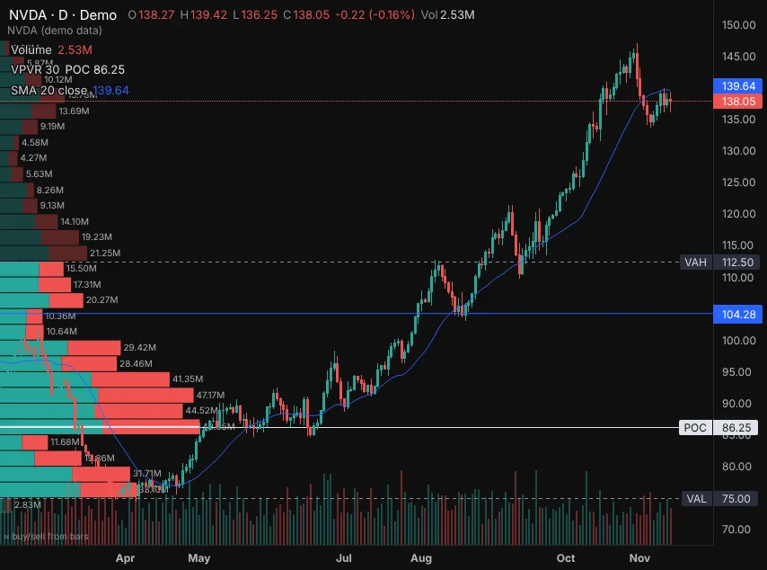
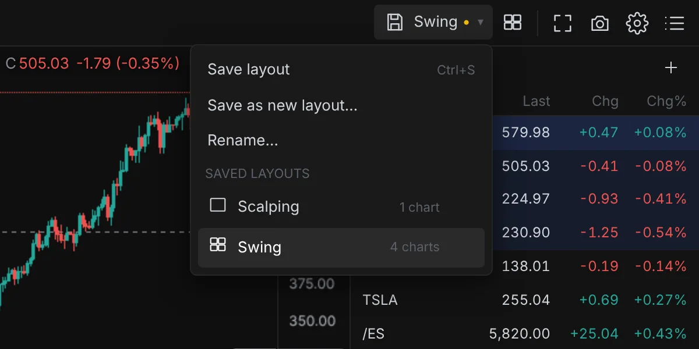
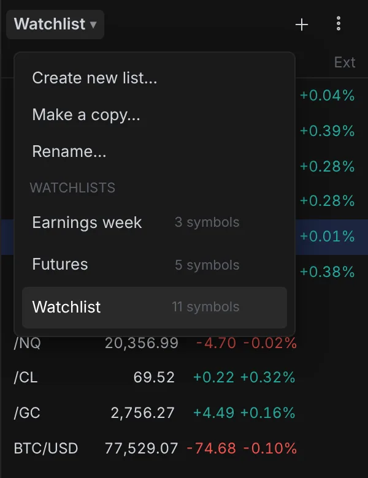
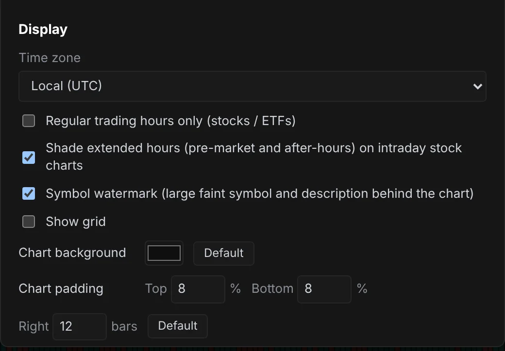

# Screenshots

Most screenshots use the built-in demo data, so the prices are synthetic. The
three-window screenshot shows live tastytrade data.

## Four-chart layout

SPY, QQQ, IWM and AAPL on 5-minute charts, each with a visible-range volume
profile, POC and value area, ticker watermarks and shaded extended hours, next
to the watchlist.

{ .screenshot loading=lazy }

## Twelve-chart layout

Twelve 5-minute charts in the 6 × 2 layout, with the watchlist hidden to give
the charts more room.

{ .screenshot loading=lazy }

## Three windows with live data

Three chart windows on live tastytrade data: twelve 1-minute charts on top, a
"4 Same Symbol" layout of SCHD across four timeframes with a "Dividend Tickers"
watchlist, and a single GOOGL daily chart with a volume profile. Each watermark
shows the ticker with the company name below it.

{ .screenshot loading=lazy }

## Price alerts

Two alerts on an NVDA chart, shown as orange lines with arrows for up and down,
and the bell menu listing them.

{ .screenshot loading=lazy }

## Extended hours shading

Pre-market and after-hours bars are shaded on intraday stock charts. The
watchlist's Ext column shows the extended-hours change.

{ .screenshot loading=lazy }

## Watermark

A large, faint ticker behind each chart. With live data the company name
appears below it.

{ .screenshot loading=lazy }

## Saved image

What the camera button saves: the chart with its legend, indicators and drawings.

{ .screenshot loading=lazy }

## Saved layouts

Switch between named layouts, such as a one-chart "Scalping" setup and a
four-chart "Swing" setup.

{ .screenshot loading=lazy }

## Watchlist

Last, change, change % and the extended-hours (Ext) column, with details for
the selected symbol at the bottom.

{ .screenshot loading=lazy width="320" }

## Several watchlists

Click the watchlist's name to switch lists, or to create, copy or rename one.

{ .screenshot loading=lazy width="320" }

## Display settings

Chart background colour and chart padding in Settings → Display.

{ .screenshot loading=lazy width="520" }
