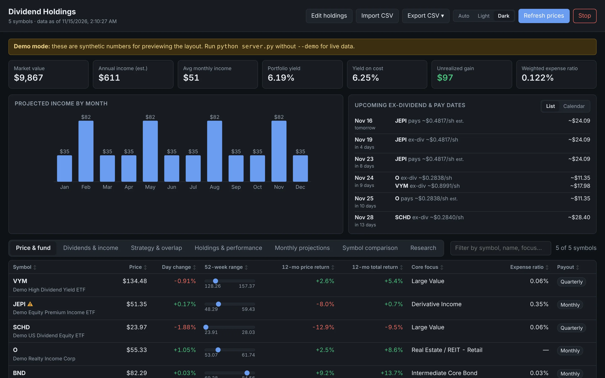

# Dividend Dashboard

A small dashboard for your dividend ETFs, funds and stocks that runs on your own
computer and opens in your web browser. It pulls free Yahoo Finance data, needs
no API key or account, and uses only Python's standard library, so there's
nothing extra to install (and nothing for Windows Smart App Control to block).

[:fontawesome-brands-github: View on GitHub](https://github.com/trader-larry/dividend-dashboard){ .md-button .md-button--primary }
[:material-rocket-launch: Get started](getting-started.md){ .md-button }

{ .screenshot }

## Why I built it

I wanted one page that answers the questions I actually ask about my dividend
holdings: how much income to expect each month, when the next ex-dividend dates
are, which funds overlap, and whether a high yield is hiding a falling price.
Brokers spread that across many screens, and most tools want an account or a
paid API key. This one keeps my holdings on my own machine.

## At a glance

| | |
|---|---|
| **Runs on** | Windows, macOS, Linux (Python 3.9 or newer) |
| **Data** | Yahoo Finance, cached for 15 minutes; optional `yfinance` fallback |
| **Your holdings** | A plain `holdings.csv` you can edit in the page or in Excel |
| **Privacy** | Runs at `http://127.0.0.1:8765`; holdings never leave your computer |
| **Dependencies** | None beyond the Python standard library |
| **License** | MIT |

## Highlights

- **Portfolio tiles:** market value, annual and monthly income, yield, yield on
  cost, unrealized gain, weighted expense ratio and the next ex-dividend date.
- **Income calendar:** projected income by month plus upcoming ex-dividend and pay dates.
- **Strategy & overlap:** what each fund is exposed to, its options strategy, and
  how much your funds' top holdings overlap.
- **Symbol comparison and Research:** compare up to 10 tickers over 1M to Max,
  or look up any symbol you don't own yet.
- **Planning:** try what-if allocations across taxable and retirement accounts,
  lock exact dollar amounts and spread the rest, see the income they'd pay by
  month, and save them as scenarios to compare against what you own now.
- **Summary:** a one-page snapshot of the whole portfolio you can save as a PNG
  or PDF, with an option to hide dollar amounts before you share it.
- **Warning flags:** very high yield, recent dividend cut, possible NAV decay,
  high expense ratio and erratic payouts.
- **Works across computers:** share one holdings file through a cloud folder, or
  export and import with a preview of every change.

See the full [feature tour](features.md) or the [screenshots](screenshots.md).

!!! note
    This is for information only, not investment advice. Data comes from Yahoo
    Finance and can be delayed, estimated or wrong.
