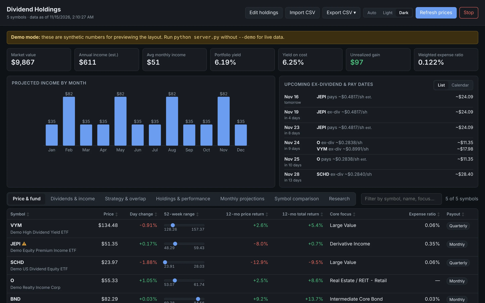
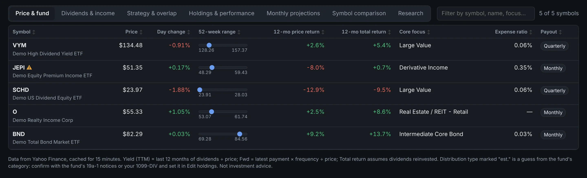
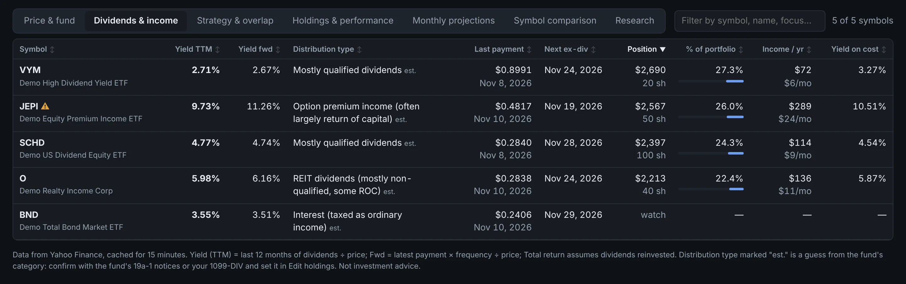
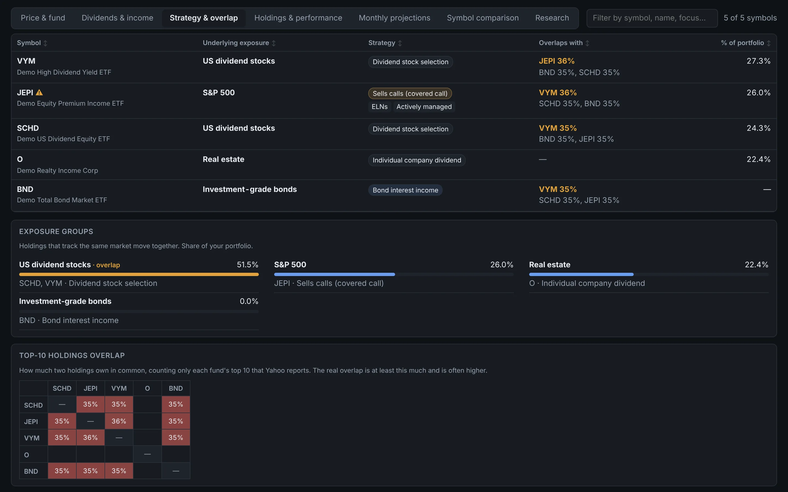
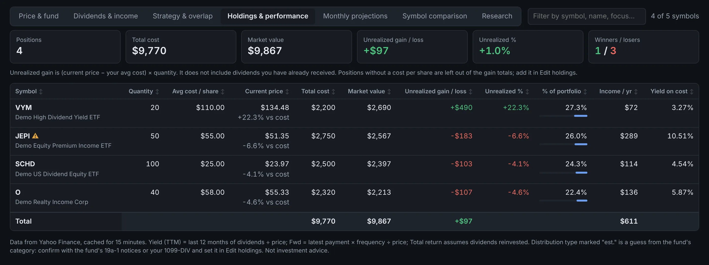
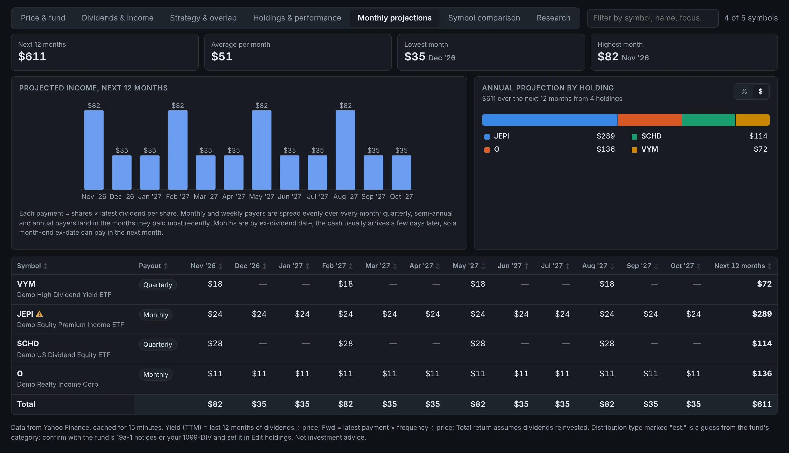
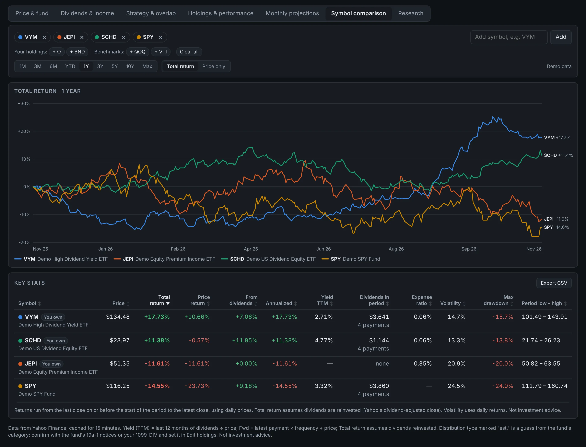
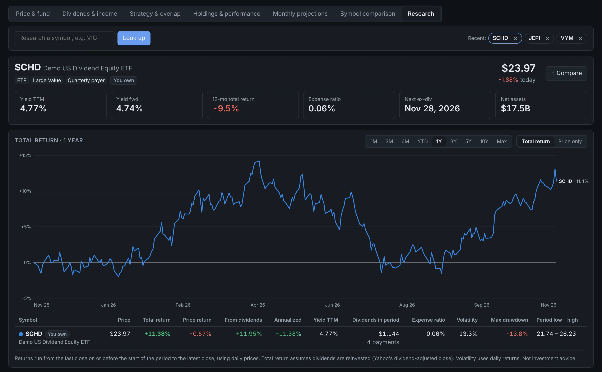
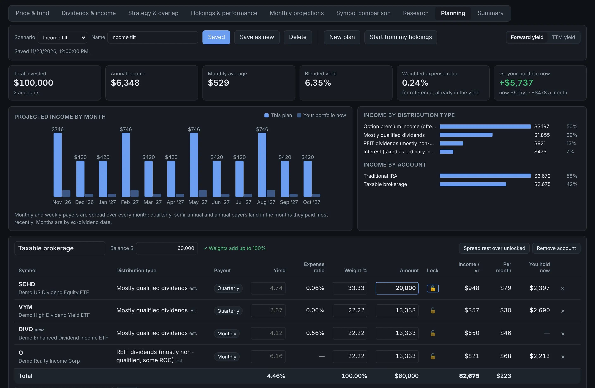
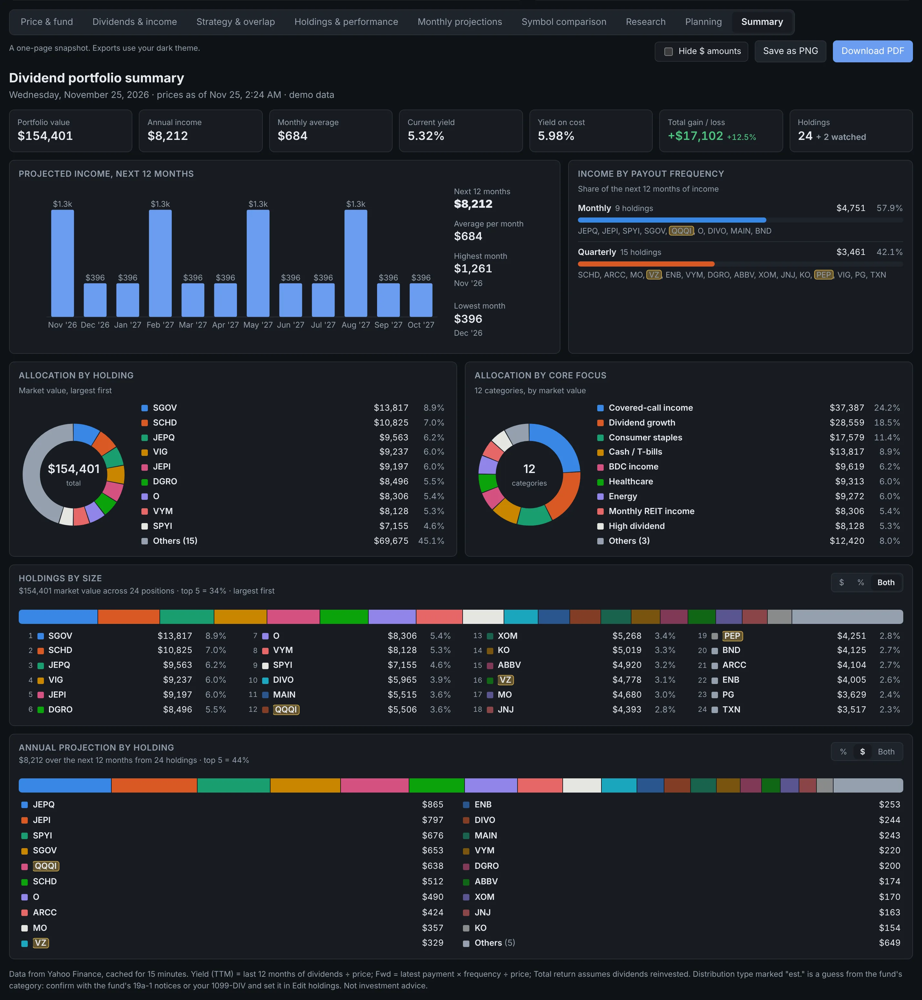

# Screenshots

All screenshots use the built-in demo data (`python server.py --demo`), so the holdings and dollar amounts are synthetic.

## Overview

Summary cards, projected income by month and upcoming ex-dividend dates.

{ .screenshot loading=lazy }

## Price & fund

Main table with price, 52-week range, category and expense ratio.

{ .screenshot loading=lazy }

## Dividends & income

Yields, frequency, next ex-dividend date and income per holding.

{ .screenshot loading=lazy }

## Strategy & overlap

Exposure, options strategy and overlap between funds.

{ .screenshot loading=lazy }

## Holdings & performance

Cost, market value, gain or loss and yield on cost.

{ .screenshot loading=lazy }

## Monthly projections

Next 12 months of income by holding.

{ .screenshot loading=lazy }

## Symbol comparison

Up to 10 tickers compared over a chosen period.

{ .screenshot loading=lazy }

## Research

Look up any symbol, held or not, or click one of your holdings below the search box.

{ .screenshot loading=lazy }

## Planning

A what-if plan across two accounts, with income by month compared with your portfolio now. SCHD is locked at $20,000 and the rest of the account is spread over the unlocked rows.

{ .screenshot loading=lazy }

## Summary

A one-page snapshot to save as a PNG or PDF: metric cards, 12-month income, income by payout frequency, allocation donuts, holdings by size and annual projection by holding.

This one uses the live demo's fuller sample portfolio (24 holdings plus 2 watched, `python server.py --public-demo` with synthetic numbers).

{ .screenshot loading=lazy }
