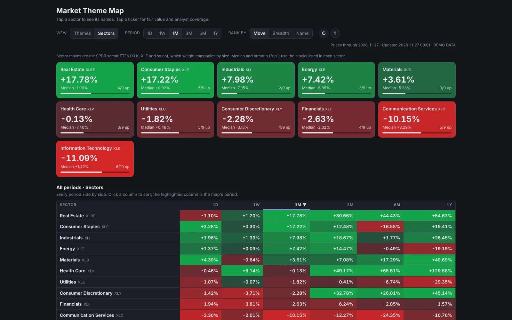
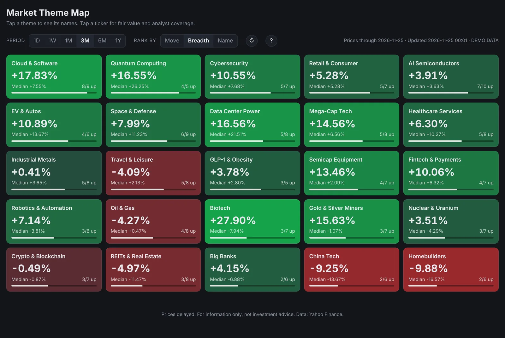
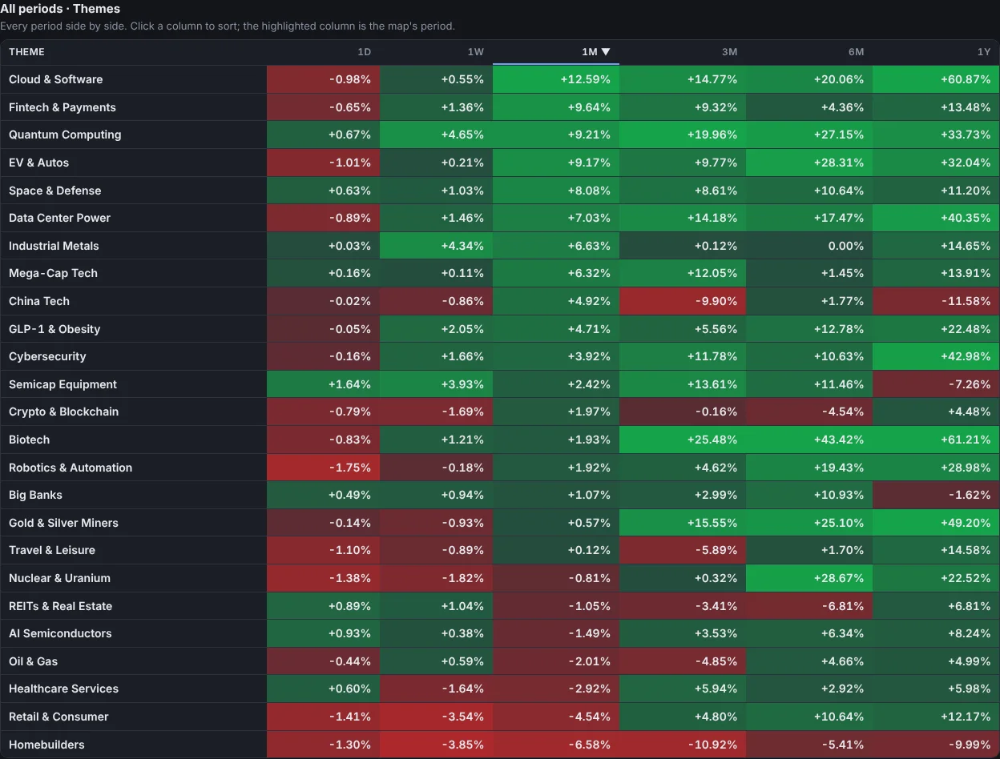
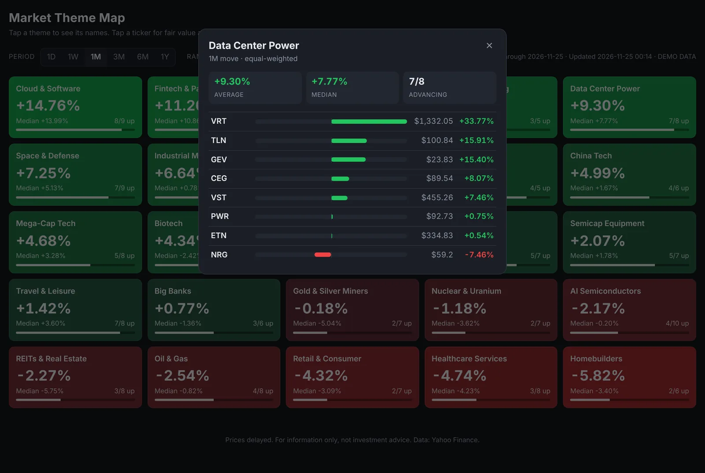
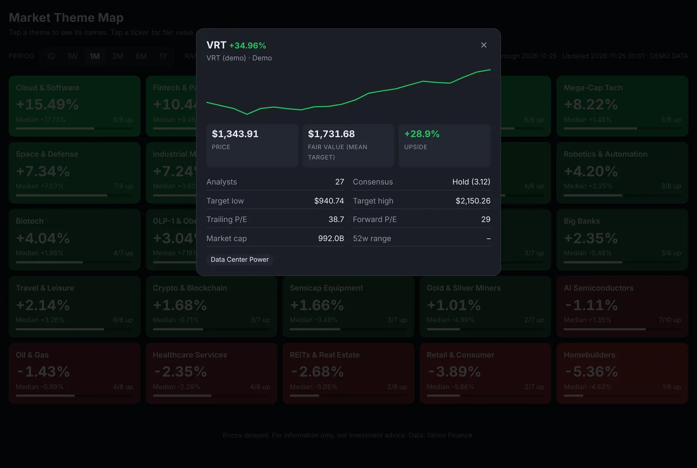

# Features

## The map

Each tile is one theme. The big number is the theme's **average move** over the
chosen period, and the tile's color follows it: green for gains, red for losses,
stronger for bigger moves. Below it are the **median** move and how many stocks
are **up** (for example 6/8 up), with a bar showing that share.

The color scale stretches with the period, because a 1Y move is much bigger than
a 1D move. A tile is fully green at +3% on 1D, +12% on 1M and +45% on 1Y.

The status line at the top right shows the last trading day in the data, when
prices were last updated, and **DEMO DATA** when you started it with `--demo`.

## Themes or sectors

The **View** switch at the top flips the map between **Themes** and
**Sectors**. Sectors are the 11 standard GICS sectors, such as Information
Technology, Health Care and Energy, each with nine or ten of its largest
companies.

A sector card's big number is the move of its State Street SPDR sector ETF
(XLK, XLV, XLE and so on), so it matches those funds, which weight companies by
size. The median and the number of stocks up come from the companies listed
under the sector. Compare the two views to see whether a hot theme is leading
its whole sector or running on its own. A stock can be in a theme and a sector
at the same time, and switching views is instant because prices for both are
downloaded together.

{ .screenshot loading=lazy }

## Periods

| Button | Lookback |
|---|---|
| 1D | 1 trading session |
| 1W | 5 sessions |
| 1M | 21 sessions |
| 3M | 63 sessions |
| 6M | 126 sessions |
| 1Y | 252 sessions |

Lookbacks count trading sessions rather than calendar days, so holidays and
weekends don't skew them. Prices are adjusted for splits and dividends.

## Ranking

- **Move** orders themes by average move, strongest first.
- **Breadth** orders them by the share of stocks that are up, with average move
  breaking ties. It shows which themes are rising together rather than on one
  or two names.
- **Name** sorts them alphabetically, handy for finding a theme quickly.

The app remembers your period and ranking for next time.

{ .screenshot loading=lazy }

## All-periods table

Below the map, a table lists every theme (or sector, following the View
switch) with its move for each period, 1D to 1Y, side by side and colored like
the tiles. Click a column heading to sort by it. By default the table follows
the map's period and ranking, with the map's period highlighted. Click a name
to open its detail.

{ .screenshot loading=lazy }

## Theme detail

Click a tile to list every stock in the theme, strongest first, with its price
and move. Each move is drawn as a bar to the right of the center line for gains
and to the left for losses, scaled to the theme's biggest mover. The average,
median and number advancing sit at the top.

{ .screenshot loading=lazy }

## Stock detail

Click a stock for:

- A price chart for the period (at least one month)
- **Fair value**, the analysts' mean price target, and the **upside** from today's price
- The low and high targets and the number of analysts
- The **consensus** rating, such as Buy or Hold, with its score (1 is strong buy, 5 is sell)
- Trailing and forward P/E, market cap and the 52-week range (worked out from the
  price history when Yahoo doesn't supply it)
- Every theme the stock belongs to

Analyst data is fetched when you open a stock and kept for 6 hours.

{ .screenshot loading=lazy }

## Your own themes

All themes live in `themes.json`, and the sectors in `sectors.json`. Add a
theme, remove one, or move stocks between them, then press **↻** in the app. See
[Change the themes](getting-started.md#4-change-the-themes) for the format.

The 25 themes it comes with:

AI Semiconductors, Semicap Equipment, Mega-Cap Tech, Cloud & Software,
Cybersecurity, Data Center Power, Nuclear & Uranium, Quantum Computing,
Crypto & Blockchain, Space & Defense, Big Banks, Fintech & Payments, Oil & Gas,
Gold & Silver Miners, Homebuilders, Biotech, GLP-1 & Obesity, Retail & Consumer,
Travel & Leisure, EV & Autos, China Tech, Robotics & Automation,
REITs & Real Estate, Industrial Metals and Healthcare Services.

## Data and refresh

- Prices come from Yahoo Finance's free, delayed chart data: 14 months of daily
  closes for every stock, so even 1Y has enough history.
- The app downloads new prices every 5 minutes, in the background, so the page
  stays responsive while it does. The page checks for new figures every minute,
  and **↻** refreshes right away.
- If Yahoo stops answering, the app keeps showing the last good data and tries
  again a minute later. The status line says the last refresh failed.
- If Yahoo skips a few symbols in one refresh, those stocks keep their previous
  prices rather than going blank.

## On your phone

The page adapts to small screens, with two tiles per row and theme and stock
panels that fit the screen (see the [phone screenshots](screenshots.md#on-a-phone)).

At home the app only listens on your own computer. To open it on your phone
anywhere, host it on Render's free plan, with an optional password (see
[Host it on Render](getting-started.md#host-it-on-render-optional)). You can
[try my copy](https://market-theme-map.onrender.com/){ target=_blank rel=noopener } the same way.

## Other touches

- No packages to install, so Windows 11's Smart App Control has nothing to block.
- **Esc** closes the open panel.
- The tests fake Yahoo's answers, so `python -m unittest` runs offline.
