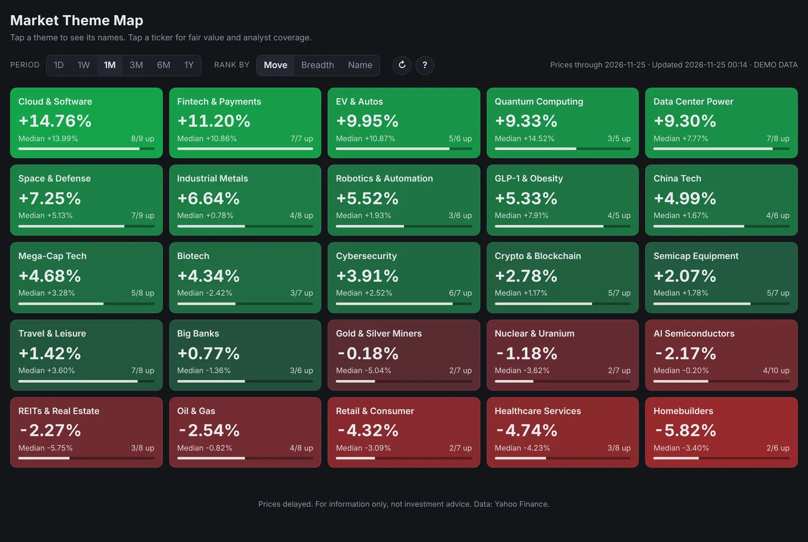

# Market Theme Map

A heatmap of the stock market grouped by investment theme, that runs on your own
computer and opens in your web browser. Each tile is a theme, such as AI
Semiconductors, Nuclear & Uranium or Homebuilders, colored by how its stocks
moved. Click a theme to see its stocks, then click a stock for its chart, the
analysts' fair value and the consensus rating.

[:fontawesome-brands-github: View on GitHub](https://github.com/trader-larry/market-theme-map){ .md-button .md-button--primary }
[:material-rocket-launch: Get started](getting-started.md){ .md-button }

{ .screenshot }

## Why I built it

Index heatmaps show me sectors, but I think about the market in themes: data
center power, nuclear, quantum, GLP-1, crypto miners. Those cut across sectors,
so a sector map hides them. I wanted one screen that tells me which themes are
working this week and which are fading, how many of their stocks are taking
part, and what analysts think the leaders are worth. This one runs locally,
needs no account or API key, and I can change the themes by editing one file.

## At a glance

| | |
|---|---|
| **Runs on** | Windows, macOS, Linux (Python 3.10 or newer) |
| **Data** | Free, delayed prices and analyst targets from Yahoo Finance, or built-in demo data |
| **Themes** | 25 themes and about 180 stocks, all in one editable file, `themes.json` |
| **Privacy** | Runs at `http://localhost:8050` and only listens on your own computer |
| **Account access** | None: no login, no API key, no broker connection |
| **Dependencies** | None: Python's standard library plus one HTML page, nothing to `pip install` |
| **License** | MIT |

## Highlights

- **Six lookbacks:** 1D, 1W, 1M, 3M, 6M and 1Y, counted in trading sessions.
- **Rank themes** by average move, by breadth (the share of stocks up), or by name.
- **Theme stats:** an equal-weighted average, the median (so one big mover
  can't distort the picture) and breadth, with a bar on every tile.
- **Theme detail:** every stock in the theme with its price and move, drawn as
  bars left and right of zero.
- **Stock detail:** a price chart, the analysts' mean price target and upside,
  low and high targets, number of analysts, consensus rating, P/E, market cap
  and 52-week range.
- **Your own themes:** add, remove or rename themes in `themes.json`, then
  press ↻ to pick them up.
- **Works on Windows 11 with Smart App Control:** no add-on packages, so there
  are no unsigned DLLs to block.

See the full [feature tour](features.md) or the [screenshots](screenshots.md).

!!! note
    This is a market overview for information only, not investment advice.
    Prices are delayed, and it is not affiliated with Yahoo.
