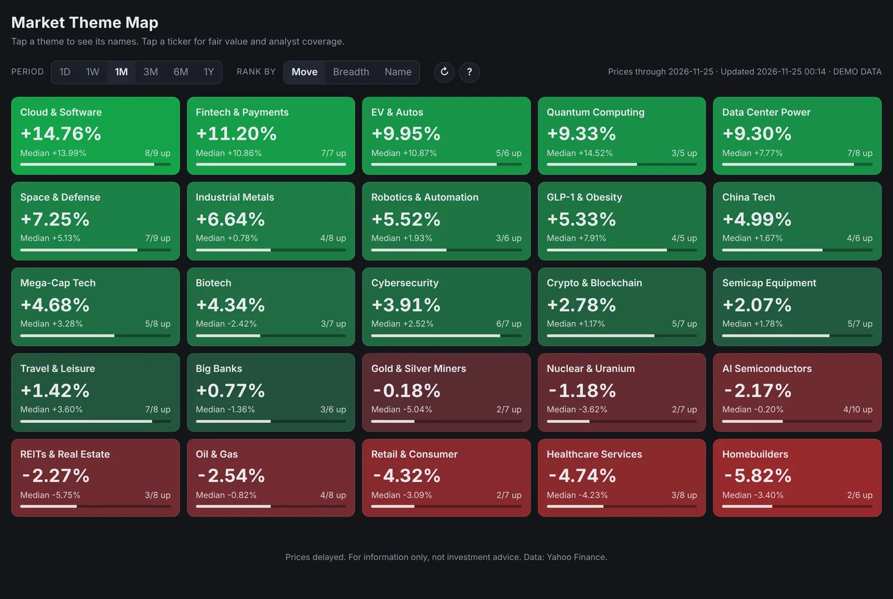
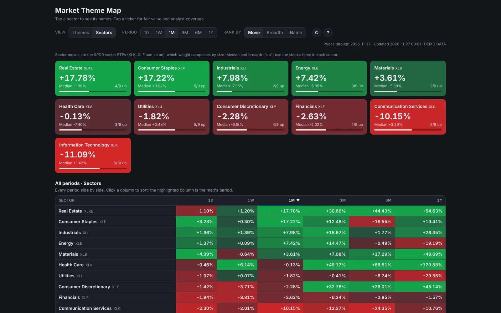
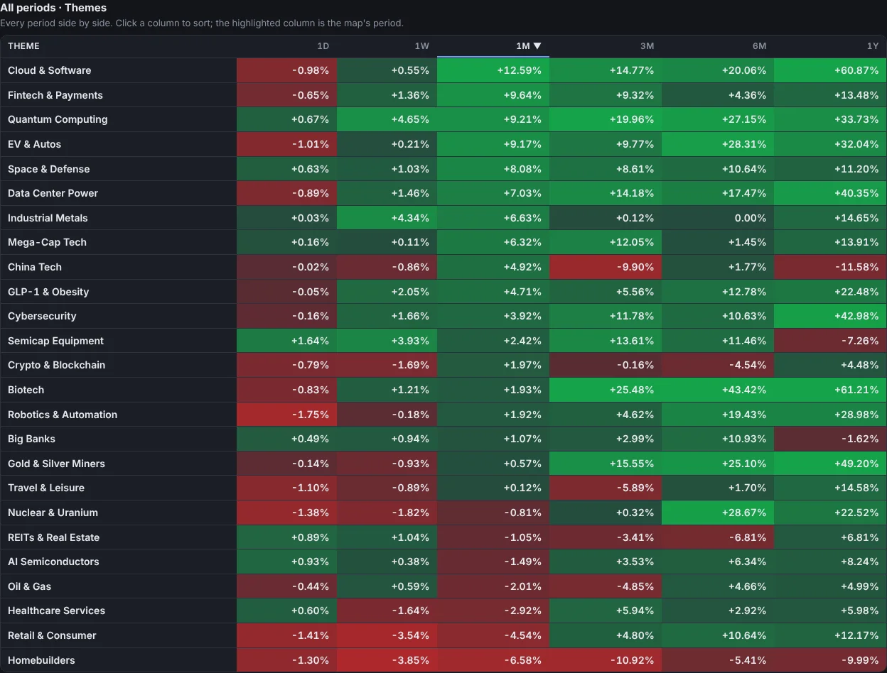
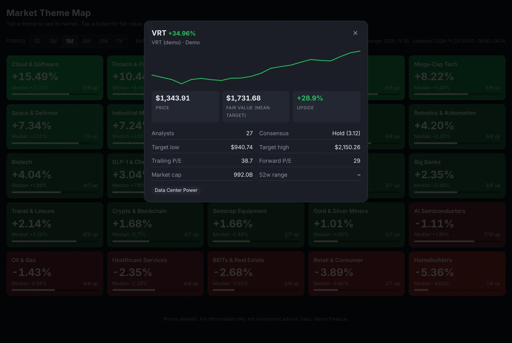
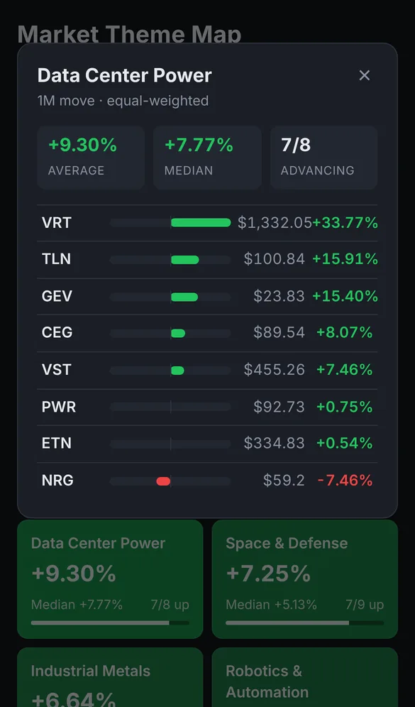
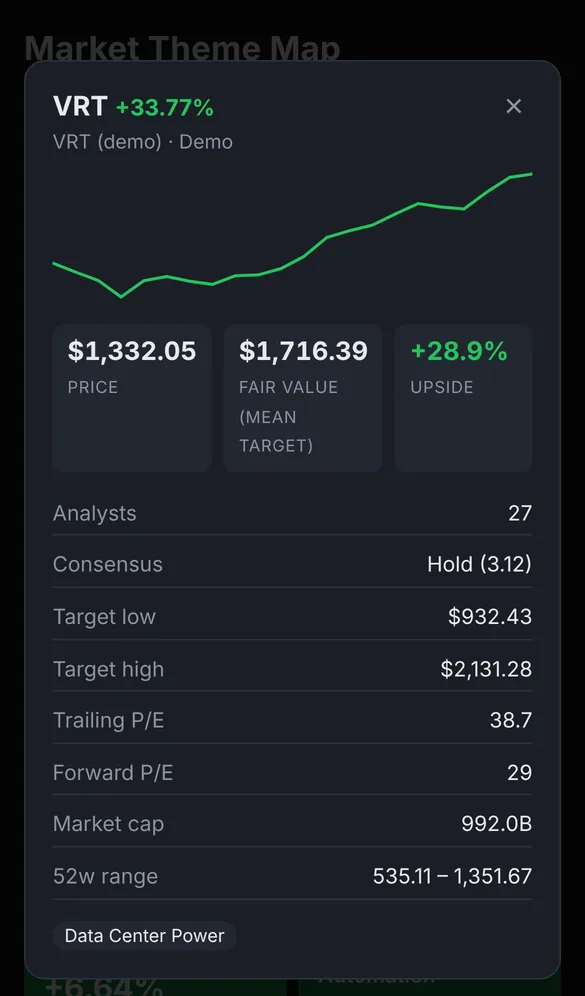

# Screenshots

All screenshots use the built-in demo data (`--demo`), so the prices, moves and
analyst figures are made up.

## The map

All 25 themes over one month, ranked by average move.

{ .screenshot loading=lazy }

## Sectors view

The 11 market sectors over one month. Each card shows its SPDR sector ETF's
move, with the all-periods table below.

{ .screenshot loading=lazy }

## All-periods table

Every theme's move for each period side by side, sorted by 1M.

{ .screenshot loading=lazy }

## Theme detail

Data Center Power's stocks, strongest first, with each move drawn left or
right of zero.

{ .screenshot loading=lazy }

## Stock detail

A stock's price chart, fair value and upside, analyst targets, consensus, P/E,
market cap and 52-week range.

{ .screenshot loading=lazy }

## Ranked by breadth

Three months, with the themes that have the most stocks up first.

{ .screenshot loading=lazy }

## How to read it

The help panel, which opens the first time and from the **?** button.

{ .screenshot loading=lazy }

## On a phone

The same app on a phone: two tiles per row, then a theme's stocks and a
stock's details in panels that fit the screen.

<figure markdown="span">
  { .screenshot loading=lazy }
  <figcaption>The map</figcaption>
</figure>
<figure markdown="span">
  { .screenshot loading=lazy }
  <figcaption>A theme's stocks</figcaption>
</figure>
<figure markdown="span">
  { .screenshot loading=lazy }
  <figcaption>A stock's details</figcaption>
</figure>

