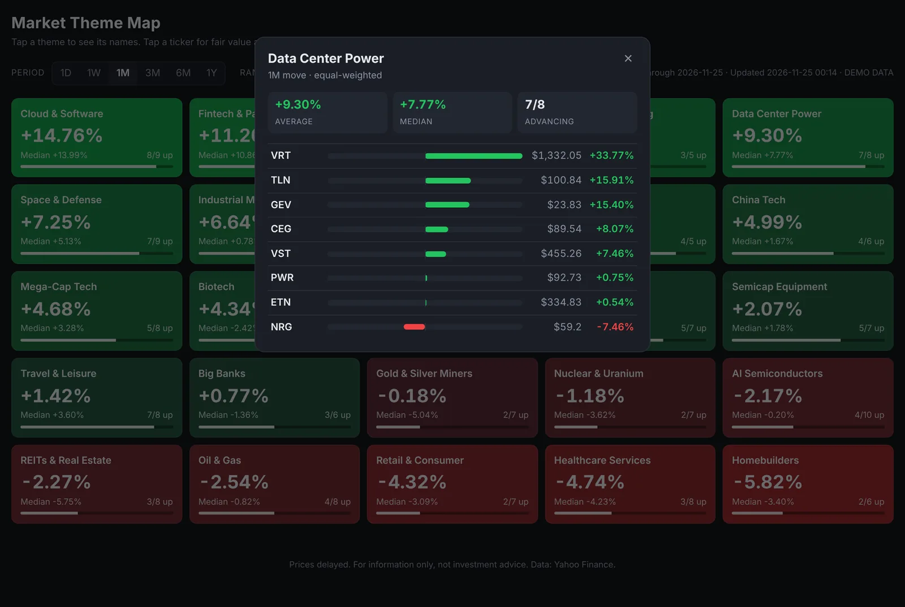
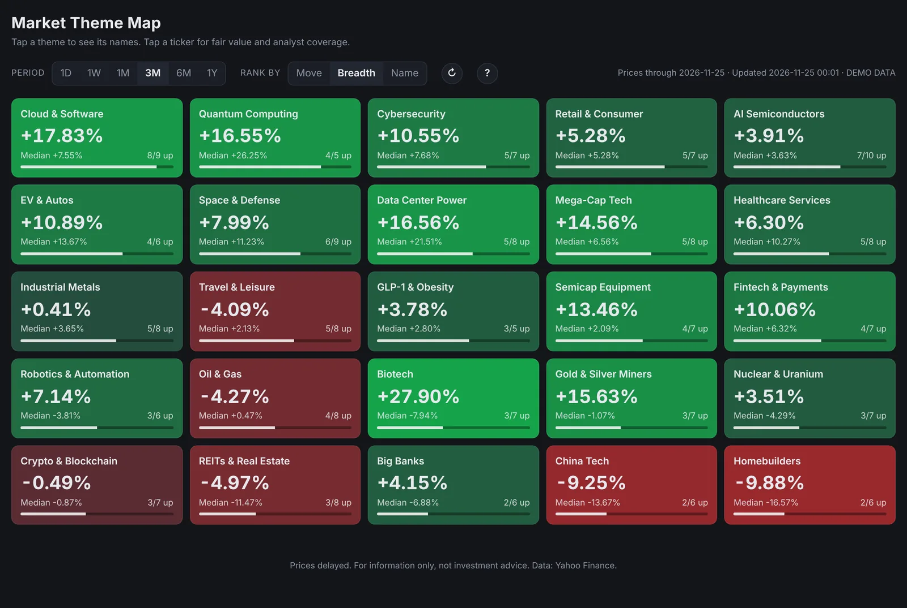
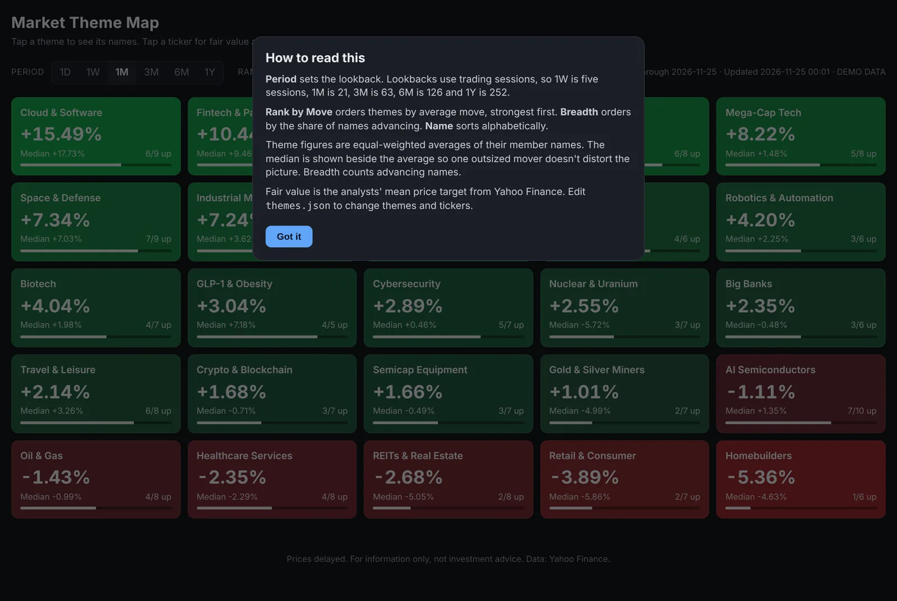
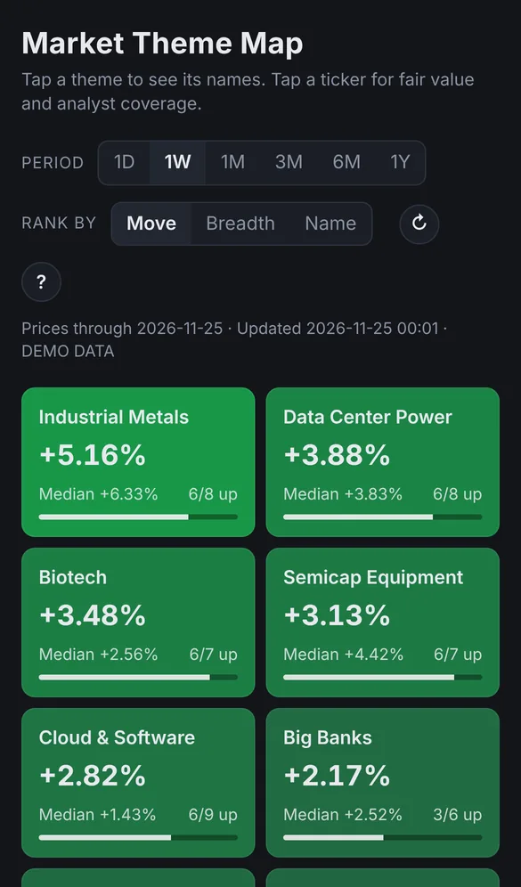

# Screenshots

All screenshots use the built-in demo data (`--demo`), so the prices, moves and
analyst figures are made up.

## The map

All 25 themes over one month, ranked by average move.

{ .screenshot loading=lazy }

## Theme detail

Data Center Power's stocks, strongest first, with each move drawn left or
right of zero.

{ .screenshot loading=lazy }

## Stock detail

A stock's price chart, fair value and upside, analyst targets, consensus, P/E
and market cap.

{ .screenshot loading=lazy }

## Ranked by breadth

Three months, with the themes that have the most stocks up first.

{ .screenshot loading=lazy }

## How to read it

The help panel, which opens the first time and from the **?** button.

{ .screenshot loading=lazy }

## On a phone

Two tiles per row on a small screen.

{ .screenshot loading=lazy width="320" }
